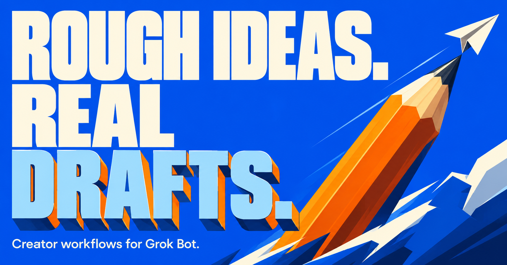
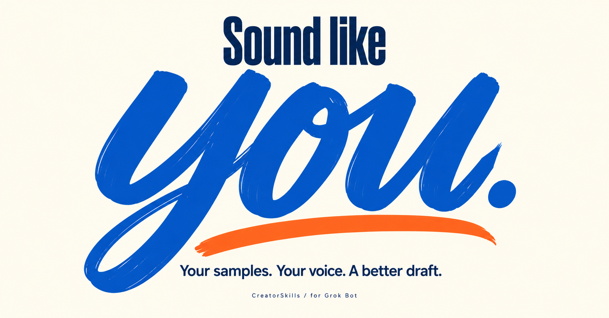
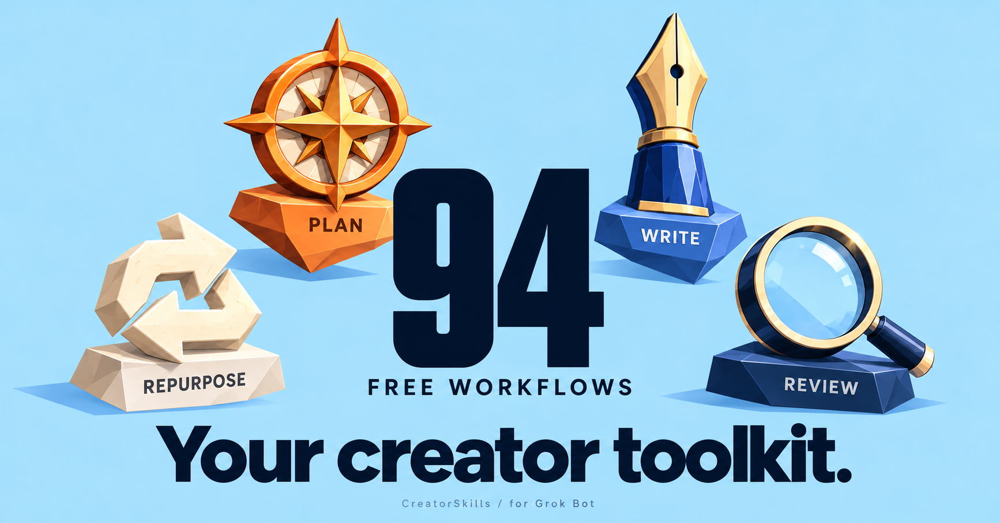

# CreatorSkills gallery

Five original advertising illustrations for review. Marketplace gallery placement is unconfirmed. These are not screenshots.

## 1. Rough ideas. Real drafts.

Creator workflows for Grok Bot: turn rough source material into useful drafts. Dimensional lettering and a sharp orange pencil on cobalt.

## 2. One source. Three formats.

Create a video script, social post and newsletter draft from one source. Illustration only: the plugin drafts text; it does not render video or publish posts.

## 3. Sound like you.

Your supplied writing samples guide the draft. Expressive cobalt lettering on warm ivory.

## 4. More views. Fewer clicks.

Worked example, clicks divided by views: 50/1,000 = 5%; 45/1,500 = 3%. This is a synthetic comparison, not customer performance.

## 5. Your creator toolkit.

94 free creator workflows: 89 owned library workflows plus 5 combined workflows. Plan, Write, Repurpose, Review. The router is not counted as an extra workflow.

The visual direction uses original dimensional lettering, cel-shaded illustration and bold graphic shapes inspired by Maxime Bourgeois. No endorsement is implied. The approved CS plugin icon is separate from these gallery images.

Full dimensions and SHA-256 hashes: [manifest.json](manifest.json).
